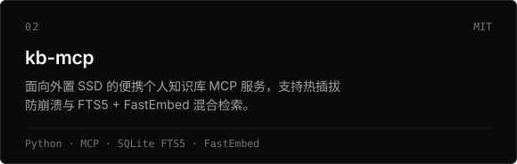
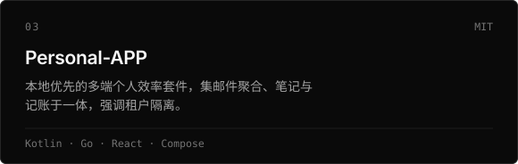
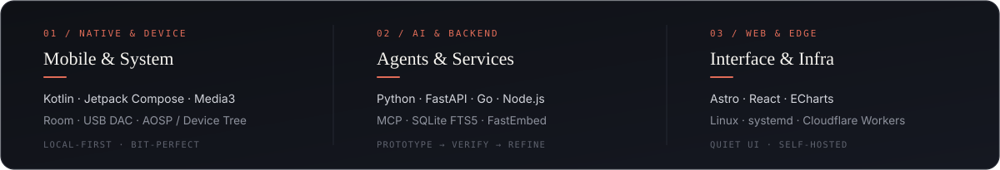
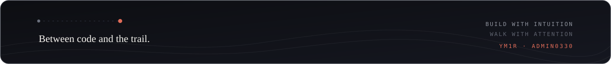

 

<a href="https://github.com/admin0330?tab=repositories">Repositories</a>
&nbsp;&nbsp;·&nbsp;&nbsp;
<a href="https://github.com/admin0330?tab=stars">Stars</a>
&nbsp;&nbsp;·&nbsp;&nbsp;
<a href="https://github.com/admin0330?tab=overview">Activity</a>

 

我是 **Ym1r**——做本地优先的原生应用、轻量 AI 工作流与自托管系统。习惯先用原型验证直觉，再删掉多余噪音，只留下清晰、克制、真正好用的部分。

 

## Selected Work

<table>
  <tr>
    <td width="50%">
      
    </td>
    <td width="50%">
      
    </td>
  </tr>
  <tr>
    <td width="50%">
      
    </td>
    <td width="50%">
      
    </td>
  </tr>
</table>

**More in the workshop** — <a href="https://github.com/admin0330/Xiaomi-15-Pro-Device-tree">Xiaomi-15-Pro-Device-tree</a> (SM8750 / HyperOS 4) · <a href="https://github.com/admin0330/wloc-locator">wloc-locator</a> (Apple WLOC &amp; Workers) · <a href="https://github.com/admin0330/my-blog">my-blog</a> (Astro)

 

## Craft & Stack

  

 

  

