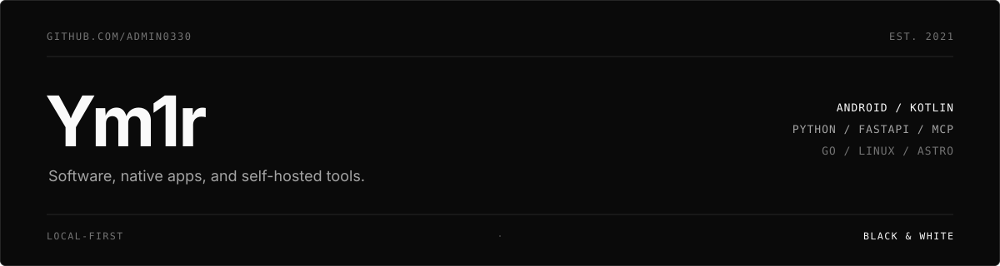
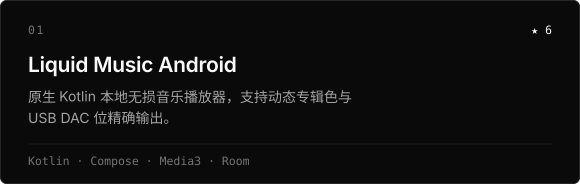
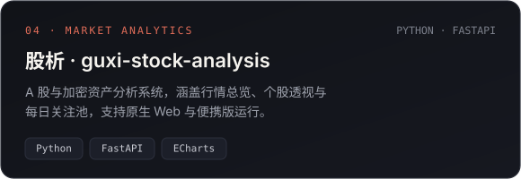

 

<a href="https://github.com/admin0330?tab=repositories">Repositories</a>
&nbsp;&nbsp;/&nbsp;&nbsp;
<a href="https://github.com/admin0330?tab=stars">Stars</a>
&nbsp;&nbsp;/&nbsp;&nbsp;
<a href="https://github.com/admin0330?tab=overview">Activity</a>

 

## Selected Work

<table>
  <tr>
    <td width="50%">
      
    </td>
    <td width="50%">
      
    </td>
  </tr>
  <tr>
    <td width="50%">
      
    </td>
    <td width="50%">
      
    </td>
  </tr>
</table>

**Other** — <a href="https://github.com/admin0330/Xiaomi-15-Pro-Device-tree">Xiaomi-15-Pro-Device-tree</a> · <a href="https://github.com/admin0330/wloc-locator">wloc-locator</a> · <a href="https://github.com/admin0330/my-blog">my-blog</a>

 

## Stack

  

