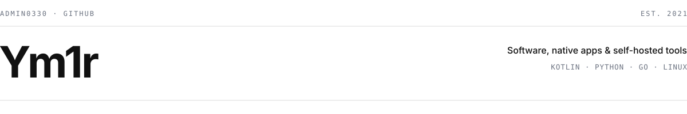

<picture>
  <source media="(prefers-color-scheme: dark)" srcset="./assets/hero-dark.svg">
  <source media="(prefers-color-scheme: light)" srcset="./assets/hero-light.svg">
  
</picture>

  <samp>
    <a href="https://github.com/admin0330?tab=repositories">repositories</a> ·
    <a href="https://github.com/admin0330?tab=stars">stars</a> ·
    <a href="https://github.com/admin0330?tab=overview">activity</a>
  </samp>

 

### Selected Work

| Project | Description | Stack |
| :--- | :--- | :--- |
| **[liquid-music-android](https://github.com/admin0330/liquid-music-android)** | 原生本地无损音乐播放器，Liquid Glass UI 与 USB DAC 位精确输出 | <samp>Kotlin · Compose · Media3 · Room</samp> |
| **[kb-mcp](https://github.com/admin0330/kb-mcp)** | 面向外置 SSD 的便携个人知识库 MCP 服务，支持热插拔防崩溃与混合检索 | <samp>Python · MCP · FTS5 · FastEmbed</samp> |
| **[Personal-APP](https://github.com/admin0330/Personal-APP)** | 本地优先的多端个人效率套件，集邮件聚合、笔记与记账于一体 | <samp>Kotlin · Go · React</samp> |
| **[guxi-stock-analysis](https://github.com/admin0330/guxi-stock-analysis)** | A 股与加密资产分析系统，涵盖行情总览、个股透视与每日关注池 | <samp>Python · FastAPI · ECharts</samp> |

<samp>more repositories</samp>

 

- **[Xiaomi-15-Pro-Device-tree](https://github.com/admin0330/Xiaomi-15-Pro-Device-tree)** — LineageOS-style device tree for `haotian` (SM8750) rebased onto HyperOS 4 vendor blobs
- **[wloc-locator](https://github.com/admin0330/wloc-locator)** — Apple WLOC 网络定位修改与坐标注入工具，支持 Cloudflare Workers 选点面板
- **[my-blog](https://github.com/admin0330/my-blog)** — 基于 Astro 搭建的极简个人博客

 

### Stack

<samp>

- **Mobile & System** — `Kotlin` · `Jetpack Compose` · `Media3` · `Room` · `AOSP / Device Tree`
- **Backend & AI** — `Python` · `FastAPI` · `Go` · `Node.js` · `MCP` · `SQLite FTS5`
- **Web & Infra** — `Astro` · `React` · `ECharts` · `Linux` · `systemd` · `Cloudflare Workers`

</samp>
