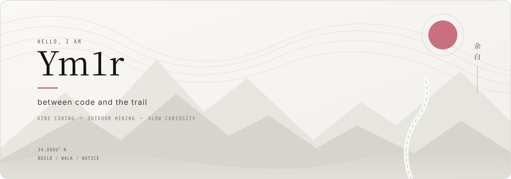
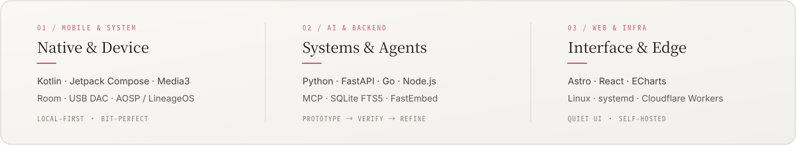

 

<a href="https://github.com/admin0330?tab=repositories">Repositories</a>
&nbsp;&nbsp;·&nbsp;&nbsp;
<a href="https://github.com/admin0330?tab=stars">Stars</a>
&nbsp;&nbsp;·&nbsp;&nbsp;
<a href="https://github.com/admin0330?tab=overview">Activity</a>
&nbsp;&nbsp;·&nbsp;&nbsp;
<a href="#山野之间">Trail Notes</a>

 

> **余白 / yohaku** — *One accent, three neutral tiers, the rest is whitespace.*

我是 **Ym1r**。做本地优先的原生应用、轻量 AI 工作流与自托管系统——习惯先用快速原型验证直觉，再把多余的噪音删掉，只留下清晰、克制、真正好用的部分。

 

## Craft & Stack

  

 

## Selected Work

<table>
<tr>
<td width="50%" valign="top">

### [Liquid Music Android](https://github.com/admin0330/liquid-music-android) &nbsp;`★ 6`

原生 Kotlin 本地无损音乐播放器。把 Liquid Glass 层次与动态专辑色带到 Android，音乐与歌词完全留在本地。

`Kotlin` `Jetpack Compose` `Media3` `Room` `USB DAC`

</td>
<td width="50%" valign="top">

### [kb-mcp](https://github.com/admin0330/kb-mcp)

面向外置固态硬盘的个人知识库 MCP 服务。具备热插拔防崩溃、FTS5 + FastEmbed 混合检索与原子大纲自愈。

`Python` `MCP` `SQLite FTS5` `FastEmbed`

</td>
</tr>
<tr>
<td width="50%" valign="top">

### [Personal-APP](https://github.com/admin0330/Personal-APP)

本地优先的多端个人效率套件，将邮件聚合、笔记与记账收拢进同一套轻量工作流，强调租户隔离与离线可用。

`Kotlin` `Compose` `Go` `React`

</td>
<td width="50%" valign="top">

### [股析 · guxi-stock-analysis](https://github.com/admin0330/guxi-stock-analysis)

A 股与加密资产分析系统，涵盖行情总览、个股透视与每日关注池，提供原生 Web 界面与便携版封装。

`Python` `FastAPI` `ECharts`

</td>
</tr>
</table>

**More in the workshop** — [Xiaomi-15-Pro-Device-tree](https://github.com/admin0330/Xiaomi-15-Pro-Device-tree) (SM8750 / HyperOS 4 rebase) · [wloc-locator](https://github.com/admin0330/wloc-locator) (Apple WLOC & Cloudflare Workers) · [my-blog](https://github.com/admin0330/my-blog) (Astro Yohaku theme)

 

## 山野之间

离开屏幕后，我去徒步。山径不追求最短路径——观察地形、选好下一步、也为未知留一点余白，和写代码其实是一样的。

 

  

