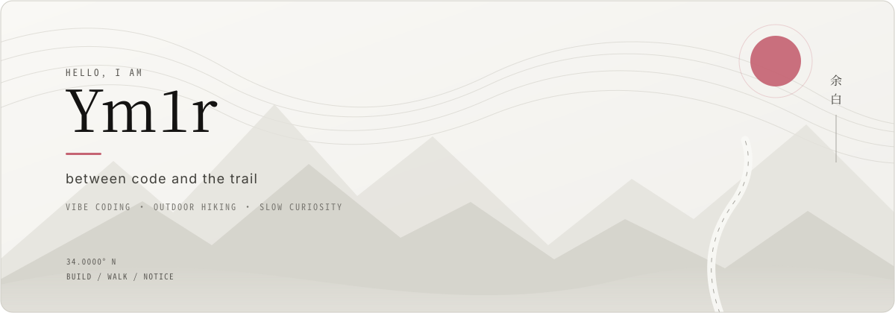

<div align="center">



<br>

<a href="https://github.com/admin0330?tab=repositories">Repositories</a>
&nbsp;&nbsp;·&nbsp;&nbsp;
<a href="https://github.com/admin0330?tab=overview">Activity</a>
&nbsp;&nbsp;·&nbsp;&nbsp;
<a href="#山野之间">Trail Notes</a>

<br><br>

</div>

> **余白 / yohaku** — 给想法一点空间，让它自然长成作品。

<br>

## 关于我

我是 **Ym1r**，一名 Cloud & Network Technology 学习者，也是一位相信直觉、保持好奇的创造者。

我喜欢把还说不清楚的念头交给代码，在对话、试验与迭代中，让它们慢慢拥有形状。比起堆叠技术名词，我更在意一件作品是否自然、清晰，以及是否真正解决问题。

<br>

<table>
<tr>
<td width="33%" valign="top">

### `01` 直觉

从一个真实的念头开始，不等待完美计划。让好奇心决定第一步。

`idea → prompt`

</td>
<td width="33%" valign="top">

### `02` 构建

用快速原型验证方向，在运行、出错与修复之间理解系统。

`prototype → learn`

</td>
<td width="33%" valign="top">

### `03` 留白

在迭代之间停下来观察。删掉噪音，让真正重要的部分留下。

`reflect → refine`

</td>
</tr>
</table>

<br>

## Vibe coding

```text
    a vague thought
          │
          ▼
   conversation  ────  curiosity
          │                 │
          ▼                 ▼
      prototype  ────  run / break / fix
          │
          ▼
    something useful
```

目前，我在用 `Linux`、`Node.js` 与 `AI-assisted workflows` 构建小而有用的系统。我的工作方式不是把判断交给 AI，而是让对话加速探索，让每次迭代都留下理解。

<br>

## Selected work

<table>
<tr>
<td width="50%" valign="top">

### YK Intelligence

运行在个人服务器上的自托管 AI 对话系统。

`Ubuntu` `Node.js` `Express` `SQLite`

多用户登录、管理控制、文件上传，以及可持续的 AI 会话工作流。

</td>
<td width="50%" valign="top">

### Server Lab

一处持续生长的 Linux 实验场。

`Linux` `systemd` `SSH` `Git` `Bash`

记录服务管理、权限配置、进程守护与部署流程中的真实经验。

</td>
</tr>
</table>

<br>

## 山野之间

离开屏幕后，我去徒步。

山径提醒我放慢速度：路径不必总是最短，停下来也是旅程的一部分。写代码与走山路很像——观察环境，选择下一步，也为未知留一点空间。

```text
trailhead  ·····  forest  ·····  ridge  ·····  somewhere quieter
```

<br>

## Footprints in code

<div align="center">


<br>

<sub>BUILD WITH INTUITION &nbsp;·&nbsp; WALK WITH ATTENTION</sub>

<br><br>

</div>
